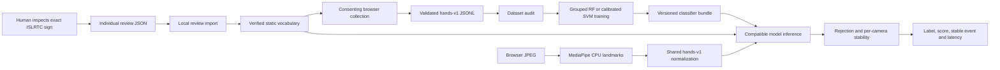

# Phase 2: verification, collection and recognition

Status: **partially complete**. Infrastructure is implemented. Human sign approval,
a genuine labelled dataset, a trained ISL classifier, real recognition evaluation and
Phase 2 laptop acceptance are pending. The user reports Phase 1 laptop capture and
landmark overlays work. That does not validate the new recognition flow.

## Reuse and architecture

The existing Tasks CPU detector, RGB decoding, explicit mirroring, 128-dimensional
`hands-v1` features, record validation, JSONL collection and grouped splitting are reused.
No new runtime framework is required. Browser capture still uses `getUserMedia`.

`backend/app/vocabulary.py` requires a human inspection attestation, official-source
confirmation, reviewer pseudonym/date, exact entry reference, observed cues and explicit
approval. Signs needing motion, facial cues, body position or relative hand placement
cannot be admitted to this feature schema. Broad index/channel URLs are rejected.
These attestations are human declarations, not automatic verification or authentication.
An ISL-competent reviewer should assess every proposed sign.

The review form exports one decision at a time. It does not mutate the registry or
unlock collection. The local `scripts.review_sign` command validates and applies that
human-authored decision. Approved references cannot be silently overwritten by this
command; revoke deliberately, recollect incompatible data and retrain. Runtime also
checks vocabulary hashes so reference changes and revocations disable affected models.

## Dataset quality and collection

The collector restricts labels to the validated reviewed registry. New recordings have
UUID IDs and an explicit sample goal (default 30). Pause/resume retains the same take;
start-new creates a new take. Progress counts **saved** samples, not frame requests.
The display shows detected hands, valid-landmark frames, unsaved frames, active time,
recording count and total saved this page. Counters are browser-session counters, not
a global dataset size. The audit reports saved totals by class.

Up to two detected hands are supported. Collection rejects the wrong number of hands
for the reviewed sign. Low handedness confidence and ambiguous duplicate handedness
are marked unreliable and never saved. Per-signer/session/class deduplication persists
across takes during a server run, requiring at least 200 ms and feature RMS movement
of 0.015 since the last saved sample. Restarting the server clears this memory; the
audit detects exact duplicate feature vectors across the saved dataset. Near-duplicate
filtering is a heuristic, not a guarantee of independent examples. Do not wave or
alter sign meaning merely to increase saved counts. Static holding may correctly stop
producing additional samples. A request already in flight when Stop/Pause/Close is
pressed may finish saving its consenting sample.

`python -m backend.training.audit` validates every row and reports class counts,
independent signers/sessions/takes, exact duplicate vectors, imbalance warnings and
fixed-split readiness. Duplicate sample IDs, duplicate frame timestamps within a take,
or recording IDs reused across labels/signers/sessions are errors. It does not verify
that the subject actually performed the intended sign. Inspect genuine recordings
live during collection, with consent; no unnecessary raw video is stored.

## Evaluation and artifacts

Train/test splitting remains deterministic (seed 42), group-aware, and rejects missing
class coverage. Default holds out signers. Session splitting groups by signer + session
and cannot demonstrate unseen-signer generalization. Structural minimums are not proof
of sufficient sample size. Aim for several signers, multiple sessions, varied independent
takes per class and balanced counts. Reserve final test signers before choosing model
settings. Never tune thresholds on final test outcomes.

RF uses 200 balanced trees. Its vote fraction is an **uncalibrated model score**. SVM
uses sigmoid calibration with GroupKFold on training groups only; every calibration
fold must contain all classes. StandardScaler is inside each fitted estimator, including
inner calibration folds, so neither scaler nor calibrator fits held-out test samples.
Insufficient calibration groups cause a clear error. Group splits are recorded in
metadata for inspection. Calibration does not establish open-set reliability.

Training CLI requires `--confirm-real-data`, a human declaration that the dataset is
real consenting browser collection rather than generated/fixture samples. This is not
a forensic authenticity check. Python callers default to `data_origin=unconfirmed`;
those bundles cannot be served. Test fixtures stay in temporary directories.

Bundle v2 includes model, class order, feature schema/dimension, library version,
training UTC time, dataset SHA256, reviewed vocabulary snapshot/hash, algorithm, seed,
confidence semantics, evaluation and fixed rejection thresholds. Separate `labels.json`,
`metadata.json` and `metrics.json` accompany it. Metrics are closed-set held-out accuracy,
macro-F1, per-class precision/recall/F1 and confusion matrix with label order. They do
not measure the deployed rejection policy, temporal events or unknown-sign recall.

## Live inference contract

Start with `MODEL_PATH` pointing to a locally trusted trained bundle, or leave it at
`backend/models/baseline/baseline.joblib`, and restart the server after training. Loading
joblib/pickle executes code: never load an untrusted downloaded classifier. Model
loading is server-controlled; there is no browser upload endpoint.

`POST /frames` retains all Phase 1 fields and adds `recognize` (default false) and
`stream_id`. Recognition requires a per-camera ID and cannot simultaneously collect.
The browser creates a fresh ID on camera/mode changes. Response retains landmarks,
features, saved/status fields and adds `quality`, `frame_latency_ms` and `prediction`.
A missing or incompatible model leaves landmark preview available. `/health` separates
API liveness, detector readiness and classifier readiness.

States: `model_unavailable`, `model_incompatible`, `no_hand`, `unreliable`, `unknown`,
`candidate`, `stable`, `error`. Rejected/unavailable states have no predicted label.
Model/score errors clear temporal stability without fake fallback predictions. Detector
failures return HTTP 503; malformed requests return 422; disabled persistence returns
403. No-hand is a normal 200 response, not an API failure.

Unknown rejection defaults to maximum class score >= 0.80, top-two margin >= 0.15 and
matching expected hand count. Thresholds are fixed engineering defaults stored in the
bundle, **not experimentally validated**. A confident unfamiliar pose can still pass.
Test natural non-vocabulary poses and withheld signs separately to measure false
acceptance before claiming useful unknown-sign rejection. No temporal/dynamic gesture
recognition or full ISL translation is implied.

Three consecutive accepted predictions for the same sign plus >= 0.5 seconds dwell are
required for stability. The displayed smoothed score is their rolling mean. No-hand,
unknown, errors, label changes, nonmonotonic time or frame gaps > 1.5 seconds reset the
run. A continuously held sign emits only once. A repeated sign requires release/change
and a per-label 2-second cooldown. State is isolated by stream, expires after 60 idle
seconds and is bounded to 128 cameras. This is a private single-user prototype; use
one worker. Recognition works best at 2–5 Hz; at 0.5 Hz the gap reset prevents stability.

`classifier_latency_ms` measures the actual model scoring call with a monotonic timer.
`frame_latency_ms` measures server decode/detection/collection/recognition work. Browser
round-trip time additionally includes image encoding, transport and response parsing.
No latency benchmark has been published; these are per-request measurements.

## Manual acceptance

1. Inspect and approve suitable exact ISLRTC sign variants individually (target 6–8,
   fewer if required; see `docs/isl_vocabulary.md`).
2. Collect genuine samples with consistent pseudonyms and held-out signers, inspect
   audit warnings, then train RF and optional group-calibrated SVM.
3. Record the generated metrics with dataset/model hashes and actual sample/group
   counts. Do not publish fixture metrics or select winners on the final test set.
4. Restart with the chosen model, enable Live recognition on the laptop, and verify
   visible labels, score, stability, cooldown, no-hand, two-hand and failure behavior.
5. Test unseen poses/signs, lighting, occlusions and new people. Document false accepts
   and false rejects. Recheck camera close and pause/resume in a real browser.

Phase 2 is complete only after those real-world checks and measured results exist.
